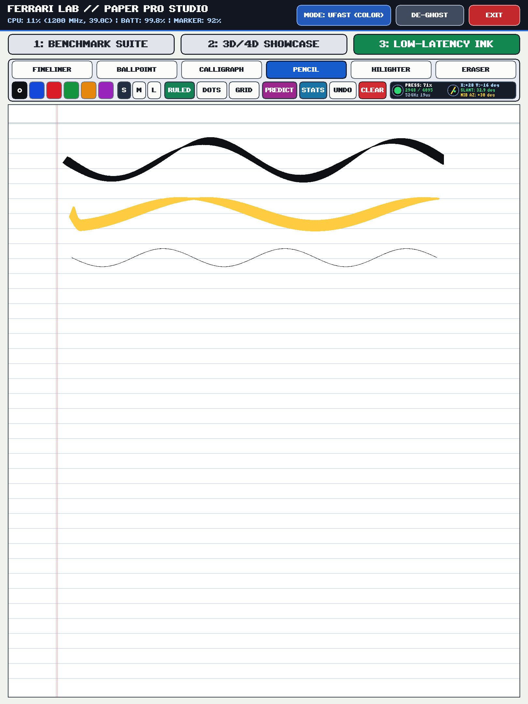
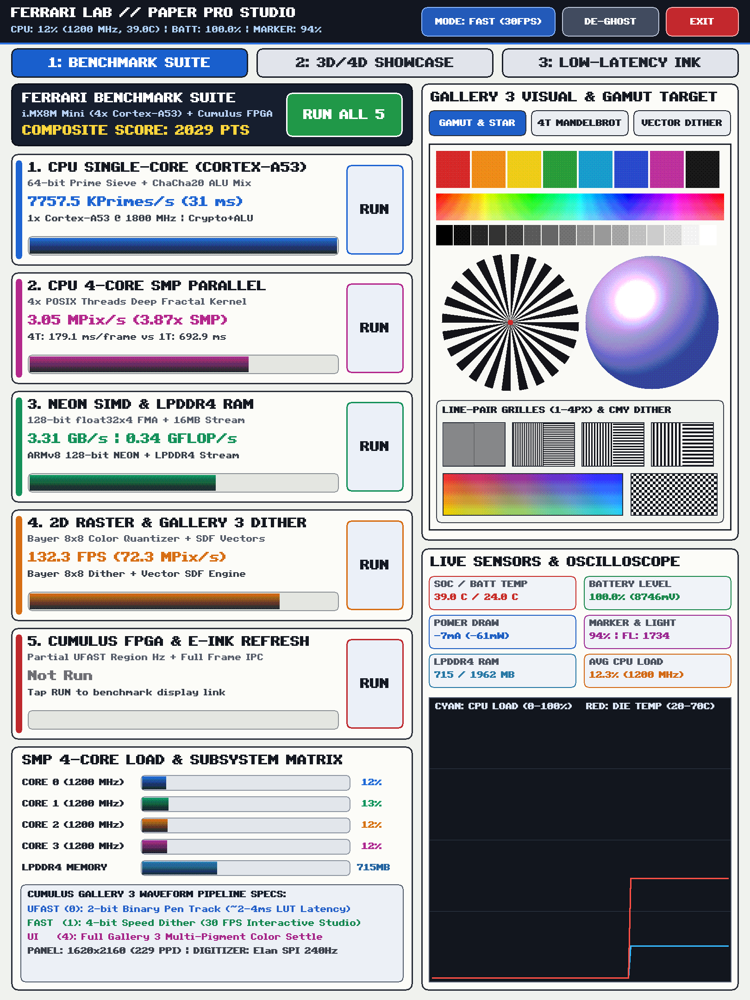
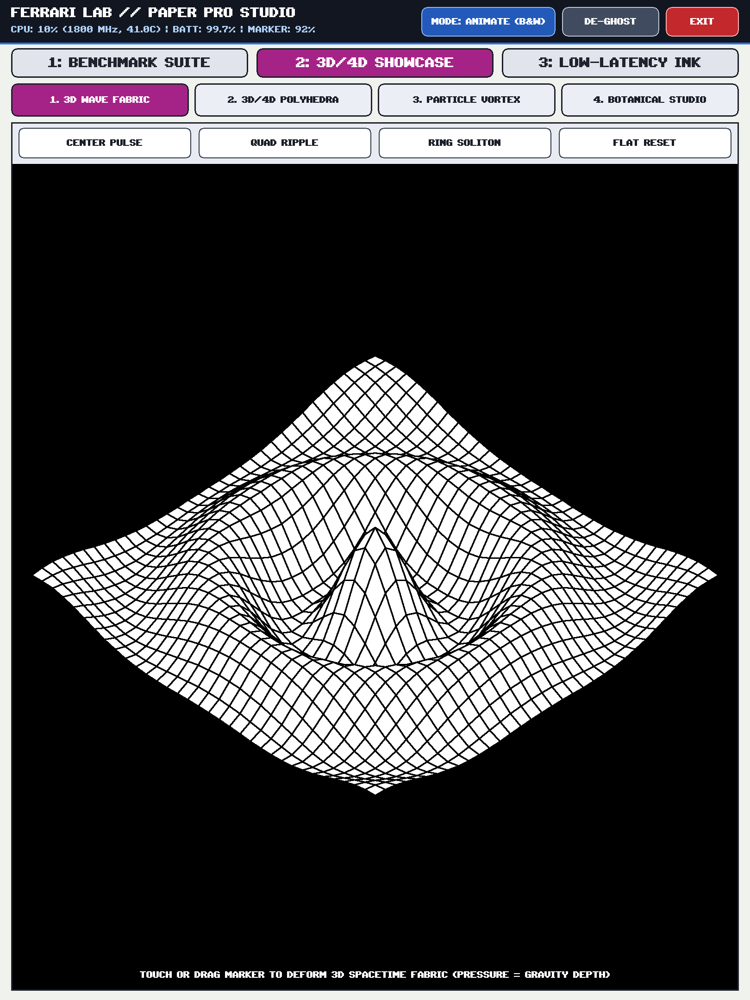

# Ferrari Lab & Low-Latency Display Engineering for reMarkable Paper Pro

A zero-dependency C++17 hardware testbench, interactive 3D/physics studio, and **240 Hz ultra-low-latency color ink engine** built for the **reMarkable Paper Pro** (`imx8mm-ferrari`), paired with a complete reverse-engineered reference on driving its **E Ink Gallery 3** display and **Cumulus FPGA** pipeline at hardware-limit latency.

<p align="center">
  
  
  
</p>

---

## Contents

- [Key Learnings: Low-Latency Display Modes on reMarkable Paper Pro](#key-learnings-low-latency-display-modes-on-remarkable-paper-pro)
- [Ferrari Lab Overview](#ferrari-lab-overview)
  - [Tab 1: Hardware Benchmark Suite & Optical Targets](#tab-1-hardware-benchmark-suite--optical-targets)
  - [Tab 2: 3D/4D Interactive Showcase](#tab-2-3d4d-interactive-showcase)
  - [Tab 3: 240 Hz Low-Latency Ink Lab](#tab-3-240-hz-low-latency-ink-lab)
- [Installation & Build Guide](#installation--build-guide)
  - [Prerequisites](#prerequisites)
  - [Quick Install (One Command)](#quick-install-one-command)
  - [Building Manually with `make`](#building-manually-with-make)
- [How to Launch & Use Ferrari Lab](#how-to-launch--use-ferrari-lab)
- [Repository Layout](#repository-layout)

---

## Key Learnings: Low-Latency Display Modes on reMarkable Paper Pro

> **Full Deep-Dive Guide:** Read [**`docs/LOW_LATENCY_DISPLAY_GUIDE.md`**](docs/LOW_LATENCY_DISPLAY_GUIDE.md) for disassembly findings, timing diagrams, and code patterns.

Driving E Ink Gallery 3 (a 4-particle Cyan/Magenta/Yellow/White microcup display) smoothly from custom `xovi` / `appload` (`qtfb`) apps requires very different strategies for **stateless fast modes** (`UFAST`, `FAST`, `ANIMATE`) versus **stateful high-accuracy color modes** (`CONTENT`, `UI`):

### 1. Choosing the Right Refresh Mode (`EPScreenMode`)
| Mode | ID | Latency | Best Strategy |
| :--- | :-: | :---: | :--- |
| **`UFAST`** | `0` | ~25–35 ms | **Fastest full-color ink & UI.** Quantize RGB via an `8×8` Bayer ordered dither straight to the 8 primary subtractive corners (`#000`, `#FFF`, `#F00`, `#0F0`, `#00F`, `#0FF`, `#F0F`, `#FF0`) so microcups snap decisively without muddy intermediate states. Supports transient velocity-predicted pen tips. |
| **`FAST`** | `1` | ~33 ms | **Grayscale speed previews.** Smooth 4-bit monochrome pan/zoom and scrubbing. |
| **`ANIMATE`** | `2` | ~20–30 ms | **15–25+ FPS interactive simulations.** Pure 1-bit `#000000` / `#FFFFFF` binary waveform with zero multi-pigment settling lag. |
| **`CONTENT` / `UI`** | `3` / `4` | ~145 ms (B/W)<br/>~550 ms (Color) | **Native two-phase high-accuracy color ink.** Instant solid black ink right at the moving pen tip (`wf=4`), followed ~180 ms behind by a real-time color accuracy conversion wave (`wf=2`) **while you continue drawing**. |

### 2. Six Critical Rules Uncovered from `swtcon` & `appload` Disassembly
1. **Never Toggle `setRefreshMode()` or `requestFullRefresh()` Mid-Stroke:** `appload.so` (`managementClientThread` at `0x2921c`) executes a hardcoded **1.0-second blocking `nanosleep()`** on every mode switch or full refresh. Keep the connection in `CONTENT` mode continuously and let `swtcon` select waveforms per update rectangle based on pixel content.
2. **Exploit `swtcon`'s Pixel-Content Waveform Classifier & Respect 60 Hz QtQuick Unioning:** In `CONTENT`/`UI` mode, `swtcon` dispatches fast ~145 ms `wf=4` if **every** changed pixel in an update rect is pure `#000000` or `#FFFFFF`, and promotes the **entire** rect to ~550 ms `wf=2` if even 1 colored pixel is present. Space dispatches by `>= 24–30 ms` (and suppress toolbar/HUD updates while `penDown` is active) so QtQuick's 60 Hz `QQuickPaintedItem::update(QRect)` never unions a monochrome pen-tip rect with a color-settle rect or distant UI widget.
3. **Schedule on Screen-Aligned `16×16` Tiles & Avoid `0x3cfe0` Active Pipe Clipping:** `swtcon` tracks active waveform pipes (`155 ms` mono, `560 ms` color) on a `16×16` pixel grid (`102 × 135` cells across `1620 × 2160`) **only on cells where pixels actually changed (`m_mask != 0`)**, clipping out any overlapping update to a busy cell. Hold back cells inside a hysteresis-stabilized pen-tip frontier box until the active Bézier curve finishes crossing them, and only set `pipeBusyUntilSec` on cells whose pixels were actually modified.
4. **Stage Shared-Memory Framebuffer (`c.fb`) Writes Until Dispatch:** Because `appload` paints directly from `mmap`'d POSIX shared memory, mutating `c.fb` inside `onPenMove()` leaks unscheduled pen-tip pixels into adjacent bounding-box repaints. Stage pending pixel states (`colorSettleState`) alongside an offscreen `paperBuf` and write `c.fb` **only** inside the `16×16` scheduler at the exact instant a cell dispatches.
5. **Subtract `1` from `(w, h)` to Cancel `FBController::markedUpdate`'s `+1` Right/Bottom Bleed:** `appload`'s `handleUpdateRegion` (`0x27dac`) builds inclusive `QRect(x, y, x + w - 1, y + h - 1)`, and `FBController::markedUpdate` (`0x2bd30`) adds `+1` to `(x2, y2)` — bleeding 1 pixel (`x2 = cx1 * 16`) into the next `16×16` tile and causing thin vertical white seam cuts on left-to-right strokes. Pass `(w - 1, h - 1)` to `updateRegion()` for pixel-exact tile bounds.
6. **Ghost-Free Gallery 3 Erasing (`FillMaskedEraser`) & Direct 240 Hz SPI Stylus Input:** Dark-scrubbing pulses trap color pigments on Gallery 3; instead, match `xochitl`'s native phase-aligned checkerboard mask (`((x + y) & 1) == 0`, alternating black/white rows) during drag and restore clean paper once on pen-up. Read `/dev/input/event2` directly (`O_NONBLOCK`) for 240 Hz sub-pixel coordinates, 4096-level pressure, physical eraser flip, and Y-inverted tilt azimuth (`atan2f(-tiltY, tiltX)`).

---

## Ferrari Lab Overview

**Ferrari Lab** (`ferrari_lab`) renders directly into a zero-copy `1620 × 2160` POSIX shared-memory framebuffer (`qtfb`) while polling the Elan Marker Plus SPI digitizer (`/dev/input/event2`) at full 240 Hz.

### Tab 1: Hardware Benchmark Suite & Optical Targets
- **5 Native Hardware Benchmarks:**
  1. Single-Core Cortex-A53 Prime Sieve + ChaCha20 ALU Mix (`KPrimes/s`)
  2. 4-Core SMP Parallel Mandelbrot Fractal (`MPix/s` & SMP scaling)
  3. 128-bit ARMv8 NEON `float32x4` FMA & 16 MB LPDDR4 Memory Stream (`GB/s` & `GFLOP/s`)
  4. 2D SDF Vector Rasterizer & `8×8` Bayer Gallery 3 Color Quantizer (`FPS` & `MPix/s`)
  5. Cumulus FPGA Partial-Update Burst & Full-Refresh IPC Benchmark (`Hz` & `ms`)
- **Gallery 3 Optical & Gamut Targets:** Primary RGBCMYWK swatches, continuous HSV spectrum, 16-step grayscale ramp, 36-spoke Siemens star, 3D Bayer sphere, and 1–4 px Ronchi line-pair grilles. **Tap any optical target** to expand it full-screen (`1620 × 2160`) with automatic hardware de-ghosting; tap with the **pen tip** to inspect exact pixel RGB/pigment values, or tap with the **eraser** (or finger) to return.
- **Live Hardware Telemetry & Dual-Trace Oscilloscope:** Real-time SoC & battery temperatures, voltage/current/power draw (`mW`), Marker Plus battery %, frontlight level, per-core CPU frequencies/loads, and LPDDR4 RAM usage.

### Tab 2: 3D/4D Interactive Showcase
- **3D Spacetime Wave Fabric:** Real-time 2D finite-difference wave equation projected in 3D (`ANIMATE` 1-bit mode); drag the Marker or finger to deform the mesh with pressure-scaled depth.
- **3D/4D Polyhedra:** Interactive wireframe/shaded polyhedra steered by finger drag or physical Marker 3D tilt angles.
- **Particle Vortex:** N-body particle simulation attracted/repelled by live stylus coordinates and tip pressure.
- **Botanical / Calligraphy Studio:** Procedural pressure-driven brush sandbox in `UFAST` color mode.

### Tab 3: 240 Hz Low-Latency Ink Lab
- **Seamless Support Across Display Modes:** Cycle the top-bar **`MODE`** button between `UFAST (COLOR)`, `FAST (30FPS)`, `ANIMATE (B&W)`, `CONTENT (HQ)`, and `UI (CRISP)`. Both **`UFAST`** (instant ~25 ms Bayer-quantized color with optional velocity tip prediction) and **`CONTENT`** (solid black pen-tip lead with real-time trailing accurate color wave, even on continuous multi-second strokes) are tuned specifically for Gallery 3.
- **6 Pressure & Tilt-Responsive Instruments:**
  - **Fineliner:** Crisp monoline ink with subtle pressure taper (`S` / `M` / `L`).
  - **Ballpoint:** Pressure-modulated ink density over `8×8` Bayer paper grain.
  - **Calligraphy:** Chisel nib whose angle rotates in real time with physical Marker Plus 3D barrel azimuth.
  - **Tilt Pencil:** Razor-sharp 1 px graphite trace when upright (`S`), transitioning smoothly into broad textured side-shading when tilted past 32°.
  - **Highlighter:** Subtractive pastel marker with per-stroke stamp deduplication (`hiliteStampGrid`) so overlapping dabs never darken within a single stroke.
  - **Eraser:** Reverse-engineered native `xochitl` `FillMaskedEraser` (also triggered automatically by flipping the Marker Plus to its physical rubber end).
- **Paper Templates, 64×64 CoW Tile Undo & Live Stylus HUD:** Toggle `RULED`, `DOTS`, or `GRID` paper backgrounds (non-destructively underneath existing strokes), instantaneous 6-step Copy-on-Write tile `UNDO`, `PREDICT` toggle, and a `STATS` HUD pill showing raw 12-bit pressure (`0..4095`), sample rate (`Hz`), dispatch time (`us`), tilt slant, and nib azimuth compass.
- **True Palm Rejection:** Finger touch is ignored on the drawing canvas (`y >= 320`) so you can rest your palm naturally while writing; toolbar buttons (`y < 320`) accept both finger and stylus taps.

---

## Installation & Build Guide

### Prerequisites
1. A **reMarkable Paper Pro** with **Developer Mode** (SSH root access) enabled.
2. [**`xovi`**](https://github.com/asivery/xovi) with the **`appload`** extension (`appload.so` + `qt-resource-rebuilder`) installed on the tablet under `/home/root/xovi/`.
3. Host computer running macOS or Linux with `ssh`/`scp` (plus either [`zig`](https://ziglang.org/) or `aarch64-linux-gnu-g++`; the install script will automatically download standalone Zig `0.13.0` into `.toolchains/` if neither is installed).

### Quick Install (One Command)

Connect your reMarkable Paper Pro via USB-C (`10.11.99.1`) or Wi-Fi (`<tablet-ip>`), then run:

```bash
chmod +x scripts/install.sh
./scripts/install.sh 10.11.99.1     # or replace with your tablet's Wi-Fi IP
```

This cross-compiles `ferrari_lab` for `aarch64-linux-gnu` (`glibc 2.38`, `-O3 -ffast-math -mcpu=cortex_a53+neon`) and installs `ferrari_lab`, `external.manifest.json`, and `icon.png` into `/home/root/xovi/exthome/appload/ferrari_lab/`.

If this is your **first time** installing Ferrari Lab, restart `xochitl` once so AppLoad picks up the new app icon:

```bash
ssh root@10.11.99.1 'systemctl restart xochitl'
```

### Building Manually with `make`

```bash
# Cross-compile ferrari_lab/ferrari_lab locally
make

# Build and deploy over SSH to a custom Wi-Fi IP
make deploy RMPP_HOST=192.168.1.100
```

---

## How to Launch & Use Ferrari Lab

1. **Launch from the Tablet UI:** On your reMarkable Paper Pro home screen, open **AppLoad** and tap **Ferrari Lab**.
   > **Note:** Always launch Ferrari Lab by tapping its icon inside AppLoad on the tablet screen rather than running `./ferrari_lab` directly over SSH — AppLoad sets the per-instance `QTFB_KEY` environment variable and attaches the full-screen `1620 × 2160` QtQuick surface.
2. **Top Header Controls:**
   - **`MODE: ...`** — Cycles hardware refresh modes (`UFAST`, `FAST`, `ANIMATE`, `CONTENT`, `UI`).
   - **`DE-GHOST`** — Triggers a full hardware Gallery 3 waveform clear (`requestFullRefresh()`).
   - **`EXIT`** — Cleanly disconnects from `qtfb` and returns to AppLoad / `xochitl`.
3. **Comparing `UFAST` vs. `CONTENT` Ink in Tab 3 (`3: LOW-LATENCY INK`):**
   - Select **`MODE: UFAST (COLOR)`** and pick a colored Fineliner, Calligraphy pen, Tilt Pencil, or Highlighter for immediate ~25 ms color dithered strokes.
   - Tap **`MODE`** until it reads **`MODE: CONTENT (HQ)`** and draw long, continuous looping strokes with Red, Yellow, Blue, Green, or Purple — observe the unbroken solid black ink right under the pen tip and the smooth, continuous color accuracy wave trailing ~180 ms behind along your stroke path.

---

## Repository Layout

```text
├── README.md                           # Project overview, installation, and usage guide
├── Makefile                            # Cross-compilation & SSH deployment targets
├── scripts/
│   └── install.sh                      # Auto-bootstrapping build + deploy script
├── docs/
│   ├── LOW_LATENCY_DISPLAY_GUIDE.md    # Deep-dive engineering guide on Paper Pro display modes
│   └── images/                         # Native 1620x2160 framebuffer screenshots
└── ferrari_lab/
    ├── main.cpp                        # Event loop, 240 Hz SPI polling, UI chrome & tab router
    ├── qtfb_protocol.h                 # Zero-copy qtfb SHM client, RawMarkerState & sysfs telemetry
    ├── gfx2d.h                         # 2D software rasterizer, 8x8 Bayer Gallery 3 dither & font engine
    ├── ink_lab.h                       # 240 Hz ink engine, 16x16 swtcon scheduler & native eraser
    ├── benchmarks.h                    # Tab 1: 5 CPU/NEON/FPGA benchmarks & Gallery 3 optical targets
    ├── showcase.h                      # Tab 2: 3D wave fabric, 4D polyhedra, particles & brush studio
    ├── external.manifest.json          # AppLoad application manifest
    └── icon.png                        # AppLoad launcher icon
```

---

## License

Released under the [MIT License](LICENSE).
