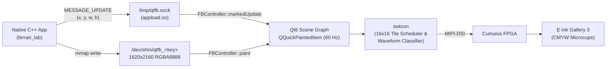

# Low-Latency Display Engineering on the reMarkable Paper Pro

A practical, reverse-engineered guide to driving the **reMarkable Paper Pro** (`imx8mm-ferrari`) **E Ink Gallery 3** color display and **240 Hz Elan SPI stylus digitizer** at hardware-limit latency via `xovi` / `appload` (`qtfb`).

Every finding in this document was verified on physical hardware using binary disassembly of `/usr/bin/xochitl` (`swtcon`) and `/home/root/xovi/extensions.d/appload.so`, microsecond pipeline traces, and external high-speed camera captures of live multi-second strokes.

---

## Table of Contents

1. [Hardware & Display Stack Architecture](#1-hardware--display-stack-architecture)
2. [Refresh Modes & Hardware Waveforms (`EPScreenMode`)](#2-refresh-modes--hardware-waveforms-epscreenmode)
3. [Mastering Stateless Fast Modes (`UFAST`, `FAST`, `ANIMATE`)](#3-mastering-stateless-fast-modes-ufast-fast-animate)
4. [Mastering High-Accuracy Color Modes (`CONTENT` & `UI`)](#4-mastering-high-accuracy-color-modes-content--ui)
   - [4.1 Pitfall 1: The 1.0-Second Blocking `nanosleep()` in `appload.so`](#41-pitfall-1-the-10-second-blocking-nanosleep-in-apploadso)
   - [4.2 Pitfall 2: `swtcon`'s Automatic Pixel-Content Waveform Classifier (`wf=4` vs `wf=2`)](#42-pitfall-2-swtcons-automatic-pixel-content-waveform-classifier-wf4-vs-wf2)
   - [4.3 Pitfall 3: `swtcon`'s 16×16 Tile Grid & Active Hardware Pipe Clipping (`0x3cfe0`)](#43-pitfall-3-swtcons-1616-tile-grid--active-hardware-pipe-clipping-0x3cfe0)
   - [4.4 Pitfall 4: Live Shared-Memory Framebuffer (`*shmImage`) Bleed](#44-pitfall-4-live-shared-memory-framebuffer-shmimage-bleed)
   - [4.5 Pitfall 5: `FBController::markedUpdate`'s `+1` Right/Bottom Off-by-One Bleed](#45-pitfall-5-fbcontrollermarkedupdates-1-rightbottom-off-by-one-bleed)
   - [4.6 Pitfall 6: Continuous Long Strokes & Self-Crossing Turnarounds](#46-pitfall-6-continuous-long-strokes--self-crossing-turnarounds)
5. [Ghost-Free Erasing on E Ink Gallery 3 (`FillMaskedEraser`)](#5-ghost-free-erasing-on-e-ink-gallery-3-fillmaskederaser)
6. [240 Hz Direct SPI Stylus Input & Coordinate Quirks](#6-240-hz-direct-spi-stylus-input--coordinate-quirks)
7. [Quick Engineering Checklist](#7-quick-engineering-checklist)

---

## 1. Hardware & Display Stack Architecture

Unlike earlier monochrome Carta devices (reMarkable 1 & 2) that used an electrophoretic black/white capsule film, the **reMarkable Paper Pro** uses an **E Ink Gallery 3 ACeP (Advanced Color ePaper)** panel (`1620 × 2160` portrait, 229 PPI) driven by a custom **Cumulus FPGA** over MIPI-DSI.

Each microcup contains **four charged pigment particle species** — **Cyan, Magenta, Yellow, and White** — suspended in clear fluid at different charge polarities and magnitudes. Producing accurate subtractive colors (such as pure yellow, bright crimson red, or deep blue) requires multi-phase voltage pulse sequences (~550 ms) to sort all four pigments cleanly in depth, whereas binary black/white displacement requires only a single rapid pulse (~25–145 ms depending on mode).

When building native apps via `xovi` + `appload` (`qtfb`), pixels traverse the following pipeline:



Understanding every stage of this chain — especially **QtQuick's 60 Hz dirty-region accumulator**, **`appload`'s rectangle math**, and **`swtcon`'s 16×16 hardware pipe tracker** — is essential for artifact-free low-latency rendering.

---

## 2. Refresh Modes & Hardware Waveforms (`EPScreenMode`)

`qtfb` exposes 6 refresh modes via `MESSAGE_SET_REFRESH_MODE` (`conn.setRefreshMode(mode)`):

| Mode ID | Constant | `EPScreenMode` | Typical Latency | Color Fidelity | Best Use Cases |
| :---: | :--- | :--- | :---: | :--- | :--- |
| **`0`** | `REFRESH_MODE_UFAST` | `UFast` | **~25–35 ms** | Fast adaptive 4096-color dither | Ultra-low-latency color & B/W drawing, responsive UI controls |
| **`1`** | `REFRESH_MODE_FAST` | `Fast` | **~33 ms** | 4-bit grayscale speed waveform | Smooth monochrome/grayscale scrubbing, pan/zoom previews |
| **`2`** | `REFRESH_MODE_ANIMATE` | `Animation` | **~20–30 ms** | Pure 1-bit Black & White binary | 15–25+ FPS 3D wireframes, wave physics, particle simulations |
| **`3`** | `REFRESH_MODE_CONTENT` | `Content` | **~145 ms (B/W)**<br/>**~550 ms (Color)** | Full multi-pulse Gallery 3 pigment accuracy | Native `xochitl`-style two-phase color ink (black lead → accurate color trail), rich illustrations |
| **`4`** | `REFRESH_MODE_UI` | `UI` | **~145 ms (B/W)**<br/>**~550 ms (Color)** | High-clarity UI & color settle | Crisp menus, dialogs, and two-phase ink with UI contrast |
| **`5`** | `REFRESH_MODE_SLEEP` | `Sleep` | Slow (~900 ms) | Static sleep-screen settle | Lock/suspend screens |

---

## 3. Mastering Stateless Fast Modes (`UFAST`, `FAST`, `ANIMATE`)

`UFAST` (`0`), `FAST` (`1`), and `ANIMATE` (`2`) behave nearly **statelessly** from the application's perspective: you can overwrite overlapping dirty regions on back-to-back frames without `swtcon` clipping out active cells. To get crisp, zero-lag performance in these modes:

### 3.1 Quantize to the 8 Subtractive Gallery 3 Corners (`8×8` Bayer Ordered Dither)
In `UFAST` mode, feeding smooth intermediate 8-bit RGB values causes Gallery 3 microcups to stall in muddy, low-saturation transitional states. Instead, quantizing RGB pixels through an **8×8 Bayer ordered dither matrix** straight to the **8 primary subtractive corners** (`#000000`, `#FFFFFF`, `#FF0000`, `#00FF00`, `#0000FF`, `#00FFFF`, `#FF00FF`, `#FFFF00` — see `ditherGallery3()` in [`ferrari_lab/gfx2d.h`](../ferrari_lab/gfx2d.h)) drives every pixel decisively toward a primary state. Colors appear crisp and saturated on the first pass.

### 3.2 Coalesce 240 Hz Input Samples into One `updateRegion()` per Poll Cycle
The Elan SPI digitizer emits 240 samples/sec (~4.16 ms apart), while QtQuick composites at 60 Hz (~16.67 ms). Drain all queued `SYN_REPORT` packets from `/dev/input/event2` in a tight non-blocking loop, tessellate all Midpoint Quadratic Bézier dabs into a single accumulated `[dirtyX0..dirtyX1, dirtyY0..dirtyY1]` bounding box, and emit **one** `conn.updateRegion()` call at the end of the batch.

### 3.3 Transient Velocity-Adaptive Tip Prediction (Stateless Modes Only)
In `UFAST` / `FAST` / `ANIMATE`, you can eliminate the remaining ~15–20 ms display pipeline lag using dual-buffer tip prediction (implemented in `LowLatencyInkLab::onPenMove` in [`ferrari_lab/ink_lab.h`](../ferrari_lab/ink_lab.h)):
1. Maintain a clean offscreen document buffer (`paperBuf`) alongside the live shared-memory framebuffer (`c.fb`).
2. On each input batch:
   - Restore the small bounding box of the previous frame's transient predicted tip from `paperBuf` back into `c.fb`.
   - Rasterize committed Midpoint Quadratic Bézier ink (`m0 → p1 → m1`) into **both** `paperBuf` and `c.fb`.
   - Rasterize a transient leading segment (`m1 → p2 → predictedTip`, projected `0..0.65×` velocity ahead of `p2`) into **`c.fb` only**.
3. On `onPenUp`, restore the transient tip and commit the final `m1 → p2` curve.

> **Important:** Disable transient tip prediction in `CONTENT` and `UI` modes! Writing and immediately erasing predicted pixels in `CONTENT`/`UI` mode locks 16×16 `swtcon` cells in 155 ms hardware pipes right in front of the moving pen tip, causing subsequent real ink dabs to get clipped out.

### 3.4 Never Update Secondary UI Regions (HUDs, Counters) While `penDown == true`
QtQuick's `QQuickPaintedItem::update(QRect)` **unions** multiple partial updates received within the same 16.67 ms VSync interval into one bounding rectangle. If you draw a stroke at `(x=900, y=1800)` and simultaneously update a stylus telemetry badge at `(x=1200, y=260)`, QtQuick unions them into a massive `300 × 1540` rectangle — ballooning memory bandwidth and latency. Suppress all non-canvas `updateRegion()` flushes while `penDown` is active, and flush the HUD immediately after pen-up.

### 3.5 Stroke-Scoped Stamp Masks for Translucent Highlighter Ink
Subtractive highlighter blending (`multiply` / darkened pastel overlay) will rapidly turn black if overlapping circular/chisel dabs within a single stroke blend atop themselves 10+ times per pixel. Maintain a 1-byte-per-pixel `hiliteStampGrid` storing `(strokeId & 0xFF)` so each pixel is blended **at most once per continuous stroke**, while still layering naturally when a second stroke crosses an earlier one.

---

## 4. Mastering High-Accuracy Color Modes (`CONTENT` & `UI`)

When drawing with color (yellow, red, blue, green, etc.) in native `xochitl`, the reMarkable Paper Pro produces a signature **two-phase ink effect**:
1. **At the moving pen tip (`0 .. ~150 ms`):** Ink appears instantaneously as a solid, unbroken jet-black trace (`wf=4`, ~145 ms).
2. **Trailing smoothly behind the pen (`~180 ms` behind the tip, *during* the stroke):** A smooth conversion wave follows along the trajectory of the stroke, converting the black trace into rich, accurate Gallery 3 pigment color (`wf=2`, ~550 ms) — even during multi-second continuous serpentine strokes.

If you try to implement this naively over `qtfb` in `REFRESH_MODE_CONTENT`, you will hit **six severe hardware/IPC pitfalls** (irregular zebra-striped cutouts in the black lead, vertical seam cuts, frozen color conversion until pen-up, or 1-second freezes). Below is the root cause and exact solution for all six.

---

### 4.1 Pitfall 1: The 1.0-Second Blocking `nanosleep()` in `appload.so`

A tempting idea is to switch `setRefreshMode(REFRESH_MODE_UFAST)` on pen-down and switch to `setRefreshMode(REFRESH_MODE_CONTENT)` on pen-up. **Do not do this.**

Disassembly of `/home/root/xovi/extensions.d/appload.so` (`managementClientThread` at `0x29170..0x29398`) reveals a hardcoded **1.0-second blocking `nanosleep()`** executed on the IPC socket thread every time a client sends `MESSAGE_SET_REFRESH_MODE` or `MESSAGE_REQUEST_FULL_REFRESH`:

```armasm
; /home/root/xovi/extensions.d/appload.so — managementClientThread
29210:  adrp    x1, 0x44000
29214:  add     x1, x1, #0xe10      ; struct timespec { tv_sec = 1, tv_nsec = 0 }
29218:  mov     x0, x1
2921c:  bl      nanosleep           ; 1,000 ms blocking sleep on socket thread!
```

**Solution:** Leave the connection in `REFRESH_MODE_CONTENT` (or `REFRESH_MODE_UI`) continuously while drawing, and rely on `swtcon`'s pixel-content waveform classifier (Section 4.2) to select fast monochrome vs. accurate color waveforms per region! Only call `setRefreshMode()` when the user explicitly clicks a mode toggle button.

---

### 4.2 Pitfall 2: `swtcon`'s Automatic Pixel-Content Waveform Classifier (`wf=4` vs `wf=2`)

Inside `CONTENT` and `UI` modes, `swtcon` inspects every changed pixel inside each submitted update rectangle:
- **Pure Binary Black/White (`#000000` and `#FFFFFF` only):** `swtcon` automatically dispatches **waveform `wf=4`** (~145 ms fast monochrome ink).
- **Any Non-B/W Pixel Present (`R != G || G != B`, or intermediate gray):** `swtcon` promotes the **entire update rectangle** to **waveform `wf=2`** (~550 ms multi-pulse Gallery 3 color settle).

**Consequences & Rules:**
1. **Never mix black pen-tip pixels and colored trail pixels inside the same `updateRegion()` rectangle.** Even a single colored pixel turns the pen-tip update into a sluggish 550 ms color flash.
2. **Space consecutive `updateRegion()` calls by `>= 24 ms` after monochrome dispatches and `>= 30 ms` after color dispatches.** Because QtQuick renders at 60 Hz (`16.67 ms` period) and a `swtcon` color commit takes ~15–20 ms on the render thread, firing a monochrome pen-tip `updateRegion()` and a trailing color `updateRegion()` less than ~24 ms apart causes `QQuickPaintedItem::update(QRect)` to **union both rectangles together** before `FBController::paint()` runs — promoting the entire span (including the pen tip!) to a 550 ms color waveform.

---

### 4.3 Pitfall 3: `swtcon`'s 16×16 Tile Grid & Active Hardware Pipe Clipping (`0x3cfe0`)

Disassembly of `swtcon` inside `/usr/bin/xochitl` reveals how the display controller manages concurrent partial updates:
- `swtcon` partitions the `1620 × 2160` panel into a **screen-aligned `16 × 16` pixel tile grid** (`102 × 135` cells).
- When an update region is committed, `swtcon` computes a changed-pixel mask (`m_mask`) per 16×16 cell and assigns active cells to a hardware waveform pipe (`~155 ms` duration for `wf=4` monochrome, `~560 ms` duration for `wf=2` color). **Cells inside the rectangle where zero pixels changed (`m_mask == 0`) are NOT locked in hardware pipes.**
- If a subsequent update overlaps any 16×16 cell whose hardware pipe is still active, `swtcon` (`0x3cfe0`) **clips out the busy cells** rather than queuing the new pixels!

**Why naive `CONTENT` drawing produces zebra stripes & missing cutouts:**
When a stylus stroke crosses a 16×16 cell over 3–4 SPI samples (~16 ms), flushing that cell on the first sample locks the entire 16×16 tile in a 155 ms pipe when only 25% of the stroke has entered it. Samples 2, 3, and 4 inside that same 16×16 tile are **clipped and dropped** by `0x3cfe0`, leaving jagged white gaps inside the black ink!

**Solution (`LowLatencyInkLab::stepSwtconPipeline` in [`ferrari_lab/ink_lab.h`](../ferrari_lab/ink_lab.h)):**
1. **Screen-Aligned 16×16 Scheduler (`swtconGrid[135][102]`):** Schedule all `CONTENT`/`UI` updates strictly on `16 × 16` screen tile boundaries (`bx0 = cx0 * 16`, `by0 = cy0 * 16`).
2. **Hysteresis-Stabilized Pen-Tip Frontier Hold Box (`U = [ux0..ux1, uy0..uy1)`):** Hold back 16×16 cells within `dabRadius + 6 px` of the active Bézier frontier (`m1..p2`), expanded by 2 cells perpendicular to the hysteresis-stabilized stroke direction (`horizDominant`), until the curve has completely finished crossing those cells (or pen motion pauses for `>= 32 ms`). Expanding `U` across the full perpendicular width of the stroke ribbon prevents ready cells behind `U` from forming L-shaped corner traps around `U`.
3. **Accurate Per-Cell `pipeBusyUntilSec` Tracking:** Set `cell.pipeBusyUntilSec = now + 0.155` (mono) or `now + 0.560` (color) **only on cells that actually had dirty pixels written** — never on untouched background paper cells inside a coalesced bounding box! Otherwise, diagonal or curved strokes falsely lock clean background cells and block nearby updates for 560 ms.

---

### 4.4 Pitfall 4: Live Shared-Memory Framebuffer (`*shmImage`) Bleed

`appload`'s `FBController` wraps your POSIX shared memory (`/dev/shm/qtfb_<key>`) directly in a `QImage` (`*shmImage`). Whenever `FBController::paint(QPainter*)` repaints a rectangular bounding box `[bx0..bx1, by0..by1)`, Qt reads **every pixel currently in `c.fb`** inside that box.

If `writeInkPixel()` writes `pureBlack` (or color) straight into `c.fb` during `onPenMove()` before a 16×16 cell is scheduled:
- Coalescing a diagonal mono batch `[cx0..cx1, cy0..cy1)` can sweep in unscheduled corner pixels from the active pen tip, locking those cells mid-dab!
- Coalescing a color batch can sweep in unscheduled color pixels that haven't even gone through their fast monochrome lead phase yet, or worse, sweep color pixels into a monochrome update!

**Solution — Staged Framebuffer Commits (`colorSettleState`):**
Never mutate `c.fb` inside `writeInkPixel()` or `settleEraserStroke()` when in `CONTENT`/`UI` mode! Instead:
- Write final accurate RGB ink into `paperBuf`.
- Record a 1-byte per-pixel staging state in `colorSettleState`:
  - `0`: Clean / settled in `c.fb`
  - `1`: Monochrome black/white currently on screen in `c.fb`, awaiting `wf=2` color settle from `paperBuf`
  - `2`: Staged pending monochrome **Black** (`#000000`) — not yet written to `c.fb`
  - `3`: Staged pending monochrome **White** (`#FFFFFF`, for live eraser checkerboard) — not yet written to `c.fb`
  - `4`: Staged pending clean restore from `paperBuf` (monochrome erase settle) — not yet written to `c.fb`
- Mutate `c.fb` **exclusively inside `stepSwtconPipeline()`** at the exact microsecond `doMono` (`2/3/4 → c.fb`) or `doColor` (`1 → paperBuf → c.fb`) dispatches that specific 16×16 cell!

---

### 4.5 Pitfall 5: `FBController::markedUpdate`'s `+1` Right/Bottom Off-by-One Bleed

Even after staging `c.fb` and aligning updates to 16×16 tiles (`x = cx0 * 16`, `w = (cx1 - cx0) * 16`), high-resolution camera captures revealed **1-pixel vertical white seam cuts** every 4 tiles (`64 px`) **only when drawing left-to-right (`cx` increasing)**, and never when drawing right-to-left (`cx` decreasing)!

Disassembling `appload` (`handleUpdateRegion` at `0x27dac..0x27dc4` and `FBController::markedUpdate` at `0x2bcc0..0x2bd64`) exposed the exact culprit:

1. `handleUpdateRegion` converts `(x, y, w, h)` into Qt's **inclusive** `QRect(x1 = x, y1 = y, x2 = x + w - 1, y2 = y + h - 1)`:
   ```armasm
   27dac:  mvni    v1.2s, #0x0             ; (-1, -1)
   27db0:  ldp     d0, d2, [x19, #0x20]    ; d0 = (x, y), d2 = (w, h)
   27dbc:  add     v0.2s, v0.2s, v2.2s     ; (x + w, y + h)
   27dc0:  add     v0.2s, v0.2s, v1.2s     ; (x2 = x + w - 1, y2 = y + h - 1)
   ```
2. `FBController::markedUpdate(QRect const&)` calls `convertQTFBRectToScreen` (which is 1:1 identity at native `1620×2160`) and then **adds `+1` to `x2` and `+1` to `y2`**:
   ```armasm
   2bd10:  movi    v0.2s, #0x1             ; (+1, +1)
   2bd1c:  fmov    d1, x1                  ; d1 = (x2, y2) = (x + w - 1, y + h - 1)
   2bd30:  add     v0.2s, v0.2s, v1.2s     ; d0 = (x + w, y + h) !!
   ```

Because Qt's `QRect` stores inclusive `(x2, y2)`, passing `x = cx0 * 16` and `w = (cx1 - cx0) * 16` causes `markedUpdate` to submit `x2 = cx1 * 16` and `y2 = cy1 * 16` — **bleeding 1 pixel across the 16×16 boundary into the first column of cell `cx1` and first row of cell `cy1`!** When drawing left-to-right, cell `cx1` is the unscheduled cell immediately ahead of the batch (still white in `c.fb`), locking that boundary in `swtcon` for 155 ms while white so the next batch clips it out!

**Solution:** Counteract `markedUpdate`'s `+1` on `(x2, y2)` by subtracting `1` from `w` and `h` in `stepSwtconPipeline`:

```cpp
int bx0 = std::max(0, cx0 * 16);
int by0 = std::max(0, cy0 * 16);
int bx1 = std::min(c.W, cx1 * 16);
int by1 = std::min(c.H, cy1 * 16);
// Counteract FBController::markedUpdate's +1 on (x2, y2) so QtQuick/swtcon
// receives exact inclusive QRect [bx0 .. bx1 - 1, by0 .. by1 - 1].
conn.updateRegion(bx0, by0, std::max(1, bx1 - bx0 - 1), std::max(1, by1 - by0 - 1));
```

---

### 4.6 Pitfall 6: Continuous Long Strokes & Self-Crossing Turnarounds

To make the color conversion wave follow smoothly behind the moving pen tip during arbitrarily long continuous strokes (rather than waiting for pen-up or converting in out-of-order blotches):

1. **Strict 1:1 Alternation (`doMono` ↔ `doColor`):** Whenever both ready monochrome pen-tip cells and ready unsettled color cells exist, alternate 1:1 between `doMono` and `doColor` (`doMono = (consecutiveMonoDispatches == 0)`). Because both phases coalesce ~4–10 cells per tick, the trailing color wave advances at the exact velocity of the pen (~180 ms behind the tip).
2. **Monotonic `monoBatchId` FIFO Wave Ordering:** Stamp each `doMono` flush with an incrementing `monoBatchId`, and forbid `doColor` from converting `oldestColorBatch` while any earlier `monoBatchId < oldestColorBatch` is still in its 155 ms monochrome pipe (`minMonoPipeBatch`). Note: only already-dispatched monochrome cells (`!cell.dirtyMono && cell.monoBatchId > 0`) should contribute to `minMonoPipeBatch`, so redrawing over a previously settled cell never stalls earlier batches.
3. **Batch-Atomic Color Merging (`batchAllReady`):** When `doColor` expands from `oldestColorBatch` to coalesce subsequent `nextBatch` IDs within `maxSpan`, only merge `nextBatch` if **100% of `nextBatch`'s cells are ready and fit** — never split a `monoBatchId` across two 560 ms color pipes.
4. **Atomic Self-Crossing Turnarounds (`effectiveMonoReadySec`):** When a stroke loops back over cells drawn ~300–500 ms earlier that are still mid-way through a 560 ms color pipe, neighboring cells in that self-crossing patch unlock across several ticks. Aligning the ready timestamp of same-pass `dirtyMono` cells within `±4` tiles (`std::fabs(nb.lastPenTouchSec - cell.lastPenTouchSec) < 0.080`) to the latest `pipeBusyUntilSec` in that neighborhood allows live unblocked stroke cells ahead of the loop to flush immediately without stalling, and then flushes the entire self-crossing patch in **one atomic batch** once the pipe clears.

---

## 5. Ghost-Free Erasing on E Ink Gallery 3 (`FillMaskedEraser`)

Multi-stage dark-scrubbing erasers (`Black → White`) that worked on monochrome Carta panels fail badly on Gallery 3: injecting a black pulse in `UFAST` mode pulls slow-moving cyan/magenta/yellow pigment particles to the viewing surface, leaving dark ghosting stains when followed by a fast white pulse.

Disassembling `/usr/bin/xochitl` (`FillMaskedEraser<uint32_t>` at `0xd13a98..0xd13ae8` and `strokev2::EraserPipeline` at `0xd1a280..0xd1a35c`) showed how reMarkable's native eraser avoids pigment ghosting completely:

1. **Live Drag (`FillMaskedEraser`):**
   - Only touches 50% of pixels inside the eraser dab where `((x + y) & 1) == 0`:
     - Even rows (`(y & 1) == 0`): writes pure **Black** (`#000000`).
     - Odd rows (`(y & 1) == 1`): writes pure **White** (`#FFFFFF`).
   - Leaves the remaining 50% of pixels (`((x + y) & 1) == 1`) untouched!
   - Visually, this renders an unmistakable crisp 50% light-gray eraser trail using **pure binary B/W pixels** (so even in `CONTENT` mode, `swtcon` classifies the live eraser trail as fast 145 ms `wf=4`!).
2. **Velocity & Tilt Scaling:** Scales the eraser radius via a cubic Hermite curve $H(t) = 3t^2 - 2t^3$ over stylus velocity ($v \in [2, 10]$ px/sample), giving surgical precision when moving slowly and wide 52 px scrubbing when sweeping rapidly.
3. **Pen-Up Settle:** Restores the erased stroke's bounding box from the clean paper template (`paperBuf`) in a single pass upon pen release.

---

## 6. 240 Hz Direct SPI Stylus Input & Coordinate Quirks

Routing pen input through `qtfb`'s `MESSAGE_USERINPUT` (`INPUT_PEN_*`) introduces socket IPC latency, integer pixel quantization, and drops tilt/hover telemetry. Instead, read `/dev/input/event2` directly with `O_RDONLY | O_NONBLOCK` (see `RawMarkerState` in [`ferrari_lab/qtfb_protocol.h`](../ferrari_lab/qtfb_protocol.h)):

- **Resolution & Sub-Pixel Mapping:** Query `EVIOCGABS(ABS_X)` (`0..11180`) and `EVIOCGABS(ABS_Y)` (`0..15340`) at startup and scale in `float` to `1620.0 × 2160.0` (~7× sub-pixel precision).
- **12-Bit Pressure & Physical Eraser Flip:** `ABS_PRESSURE` spans `0..4095`; `BTN_TOOL_RUBBER` automatically engages the eraser when the Marker Plus is flipped upside down.
- **Tilt Azimuth Y-Inversion:** `ABS_TILT_X` and `ABS_TILT_Y` are reported in hundredths of a degree (`-9000..+9000`). In Paper Pro screen coordinates (`+X` right, `+Y` down), **negate `tiltY`** (`atan2f(-(float)tiltY, (float)tiltX)`) so calligraphy chisel nib rotation and pencil side-shading match physical barrel orientation.
- **Zero-Cost Palm Rejection:** Ignore `MESSAGE_USERINPUT` touch events (`INPUT_TOUCH_*`) inside the paper canvas (`y >= PY`) and accept only `/dev/input/event2` stylus samples for drawing, while allowing finger touch on toolbar buttons (`y < PY`).

---

## 7. Quick Engineering Checklist

| Goal / Symptom | What To Do |
| :--- | :--- |
| **Lowest-latency color/B&W drawing (`~25 ms`)** | Use `REFRESH_MODE_UFAST` (`0`), quantize colors with `8×8` Bayer dither to the 8 RGBCMYWK corners, batch 240 Hz SPI samples into 1 `updateRegion()` per poll, and use dual-buffer transient tip prediction. |
| **Highest-FPS interactive 3D / physics (`15–25+ FPS`)** | Use `REFRESH_MODE_ANIMATE` (`2`) with pure `#000000` / `#FFFFFF` rendering. |
| **1-second freeze when changing modes or refreshing** | Never call `setRefreshMode()` or `requestFullRefresh()` mid-stroke or per-frame (`appload.so` sleeps `1.0s` on its IPC thread). |
| **Zebra stripes / missing black cutouts in `CONTENT` mode** | Schedule on screen-aligned `16×16` tiles, hold back the active pen-tip frontier box `U`, stage pixels out of `c.fb` until dispatch, and track `pipeBusyUntilSec` (`155 ms` mono / `560 ms` color) **only** on modified cells. |
| **1 px vertical white seam cuts on left-to-right strokes** | Pass `(w - 1, h - 1)` to `conn.updateRegion(x, y, w - 1, h - 1)` to cancel `FBController::markedUpdate`'s `+1` on inclusive `QRect(x2, y2)`. |
| **Color ink doesn't convert until pen-up (or flashes whole stroke)** | Space dispatches by `>= 24–30 ms` so QtQuick (60 Hz) never unions mono + color rects, and alternate `doMono` ↔ `doColor` 1:1 with strict `monoBatchId` FIFO ordering. |
| **Sudden full-screen slowdown while drawing** | Suppress toolbar/HUD `updateRegion()` calls while `penDown == true` so QtQuick doesn't union distant dirty rects. |
| **Dark ghosting trails when erasing color ink** | Use `xochitl`'s `((x + y) & 1) == 0` alternating black/white row mask during drag and restore clean paper once on pen-up. |
